---

title: Retratos

---

Estamos en la Base de Datos del sistema. En la página se lista una breve referencia de cada uno de los retratos que ya están incluidos en ella: fotografía, nombre, denominación, dónde se encuentra (con número de catálogo) y localización.

Por medio de sus enlaces, accederán a una ficha completa de cada retrato, con información sobre museología, retratística, complementos, sociología, bibliografía y relaciones. Estos datos se irán completando progresivamente.

|Retrato|Datos|
|-|-|
||**[[Pad001\|Pad001]]** ─ **Señora sobre madera en tonos pastel, con restos de enfardado**
Ubicación:Colección privadaGénero y procedencia:Mujer de procedencia desconocidaTécnica y soporte:Encáustica sobre madera
|
||**[[Pad002\|Pad002]]** ─ **Joven con mechón juvenil, corona y fondo dorado**
Ubicación:Bowdoin College Museum of Art (2015.38), Brunswick, Maine (ME), EE. UU.Género y procedencia:Hombre de procedencia desconocidaTécnica y soporte:Encáustica sobre madera de tilo
|
||**[[Pad003\|Pad003]]** ─ **Hombre de rostro alargado encastrado en un cartonnage**
Ubicación:Fondation Gadur pour l'Art (FGA-ARCH-EG-0593), Ginebra, SuizaGénero y procedencia:Hombre de procedencia desconocidaTécnica y soporte:Encáustica sobre madera
|
||**[[Pad004\|Pad004]]** ─ **Adulto con el cuerpo de perfil**
Ubicación:Kom Aushim Museum, Karanis, EgiptoGénero y procedencia:Hombre de procedencia desconocidaTécnica y soporte:Técnica indeterminada sobre madera
|
|[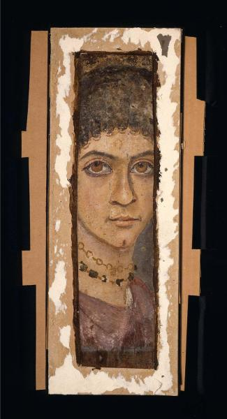](Seccion-retratos/Pad005.md)|**[[Pad005\|Pad005]]** ─ **Retrato de dama cortado en vertical**
Ubicación:Museum of Fine Arts (93.1451), Boston, Massachusetts (MA), EE. UU.Género y procedencia:Mujer de procedencia dudosaTécnica y soporte:Témpera sobre madera
|
||**[[Pad006\|Pad006]]** ─ **Joven con peinado de melón y fondo dorado**
Ubicación:The Museum of Fine Arts (2009.16), Houston, Texas (TX), EE. UU.Género y procedencia:Mujer de procedencia desconocidaTécnica y soporte:Encáustica sobre madera
|
|[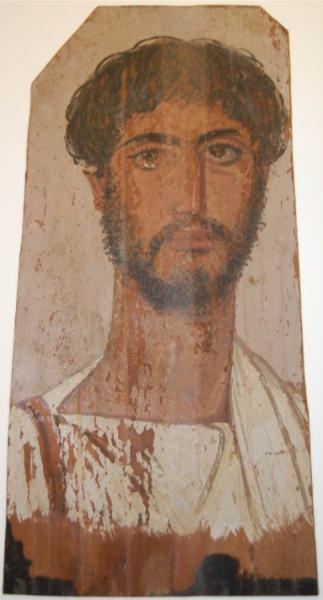](Seccion-retratos/Pad007.md)|**[[Pad007\|Pad007]]** ─ **Hombre de frente con pelo ondulado, bigote y barba**
Ubicación:Rijksmuseum van Oudheden (F 1949/3.1), Leiden, Países BajosGénero y procedencia:Hombre de procedencia desconocidaTécnica y soporte:Técnica desconocida sobre madera
|
||**[[Pad008\|Pad008]]** ─ **Niño con corona girado a la izquierda con vestidura imperceptible**
Ubicación:Rijksmuseum van Oudheden (F 1996/12.1), Leiden, Países BajosGénero y procedencia:Hombre de procedencia desconocidaTécnica y soporte:Técnica indeterminada sobre madera
|
||**[[Pad009\|Pad009]]** ─ **Hombre de rostro anguloso y flequillo a virgola**
Ubicación:Petrie Museum of Egyptian Archaeology (LDUCE-UC33971), Londres, Reino UnidoGénero y procedencia:Hombre procedente de HawaraTécnica y soporte:Encáustica sobre madera de tilo
|
|[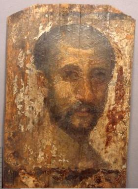](Seccion-retratos/Pad010.md)|**[[Pad010\|Pad010]]** ─ **Hombre de torso desnudo con entradas, girado a la izquierda**
Ubicación:Petrie Museum of Egyptian Archaeology (LDUCE-UC79360), Londres, Reino UnidoGénero y procedencia:Hombre procedente de HawaraTécnica y soporte:Encáustica sobre madera de tilo
|
|[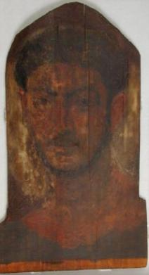](Seccion-retratos/Pad011.md)|**[[Pad011\|Pad011]]** ─ **Hombre de rostro rectangular y vestiduras sin pintar**
Ubicación:Petrie Museum of Egyptian Archaeology (LDUCE-UC30082), Londres, Reino UnidoGénero y procedencia:Hombre procedente de HawaraTécnica y soporte:Encáustica sobre madera de tilo
|
|[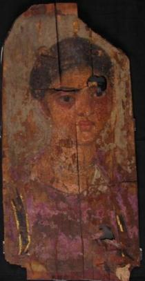](Seccion-retratos/Pad012.md)|**[[Pad012\|Pad012]]** ─ **Mujer con un pasador dorado**
Ubicación:Petrie Museum of Egyptian Archaeology (LDUCE-UC38102), Londres, Reino UnidoGénero y procedencia:Mujer procedente de HawaraTécnica y soporte:Encáustica sobre madera de tilo
|
|[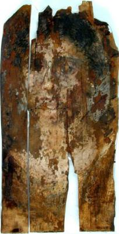](Seccion-retratos/Pad013.md)|**[[Pad013\|Pad013]]** ─ **Mujer joven de Hawara en pésimo estado**
Ubicación:Petrie Museum of Egyptian Archaeology (LDUCE-UC40698), Londres, Reino UnidoGénero y procedencia:Mujer procedente de HawaraTécnica y soporte:Encáustica sobre madera
|
|[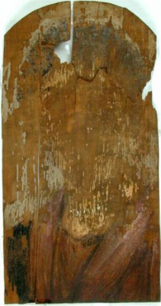](Seccion-retratos/Pad014.md)|**[[Pad014\|Pad014]]** ─ **Retrato de mujer con orario**
Ubicación:Petrie Museum of Egyptian Archaeology (LDUCE-UC45002), Londres, Reino UnidoGénero y procedencia:Mujer procedente de HawaraTécnica y soporte:Encáustica sobre probable madera de tilo
|
|[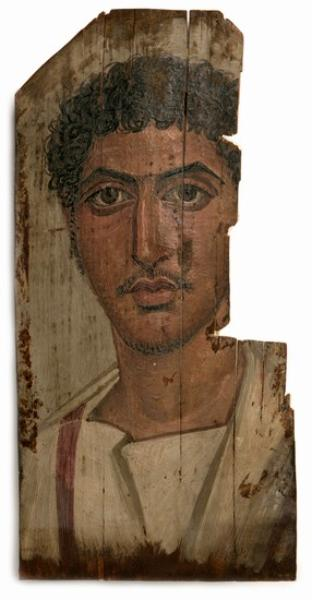](Seccion-retratos/Pad015.md)|**[[Pad015\|Pad015]]** ─ **Panel con el tercio superior derecho perdido**
Ubicación:Manchester Museum, The University of Manchester (13750), Manchester, Reino UnidoGénero y procedencia:Hombre de procedencia desconocidaTécnica y soporte:Encáustica sobre madera
|
|[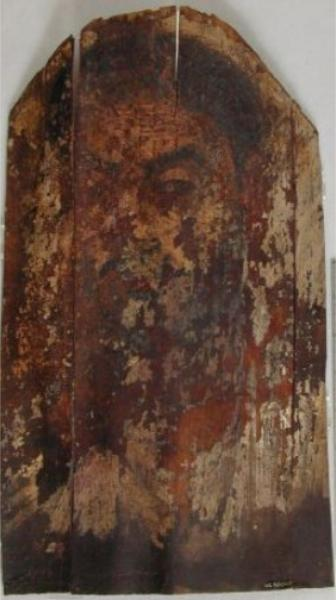](Seccion-retratos/Pad016.md)|**[[Pad016\|Pad016]]** ─ **Hombre apenas visible con ceja poblada**
Ubicación:Petrie Museum of Egyptian Archaeology (LDUCE-UC38060), Londres, Reino UnidoGénero y procedencia:Hombre procedente de HawaraTécnica y soporte:Encáustica sobre madera de tilo
|
|[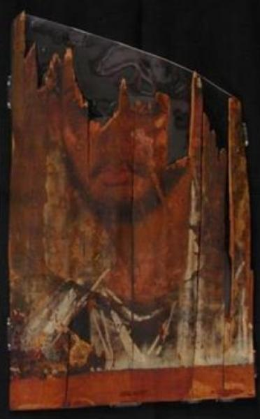](Seccion-retratos/Pad017.md)|**[[Pad017\|Pad017]]** ─ **Panel con la cuarta parte superior perdida**
Ubicación:Petrie Museum of Egyptian Archaeology (LDUCE-UC40697), Londres, Reino UnidoGénero y procedencia:Hombre procedente de HawaraTécnica y soporte:Encáustica sobre madera de tilo
|
|[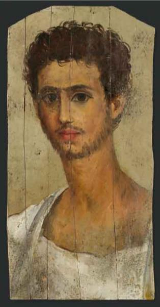](Seccion-retratos/Pad018.md)|**[[Pad018\|Pad018]]** ─ **Joven de pelo rizado y largo cuello**
Ubicación:Colección privadaGénero y procedencia:Hombre de procedencia desconocidaTécnica y soporte:Técnica mixta (encáustica/témpera) sobre madera
|
|[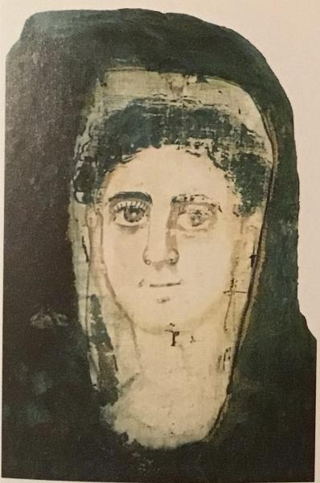](Seccion-retratos/PIV0748.md)|**[[PIV0748\|PIV0748]]** ─ **Retrato en su momia pintado sobre papiro**
Ubicación:Kom Aushim Museum (432), Karanis, EgiptoGénero y procedencia:Hombre procedente de Deir el-BanatTécnica y soporte:Témpera sobre papiro
|
|[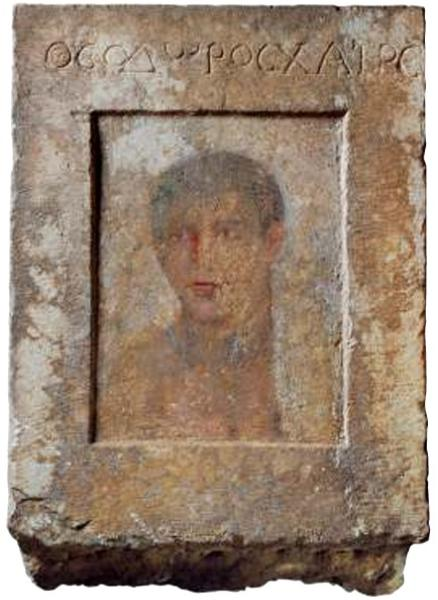](Seccion-retratos/Rad001.md)|**[[Rad001\|Rad001]]** ─ **Retrato sobre estela en piedra**
Ubicación:[Archaeological Museum of Thebes, Tebas, GreciaGénero y procedencia:Hombre procedente de Tebas (Beocia, Grecia)Técnica y soporte:Indeterminada sobre piedra
|

