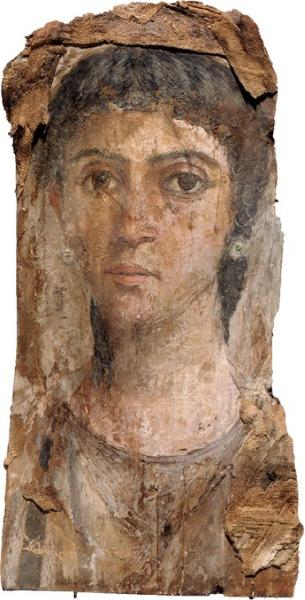
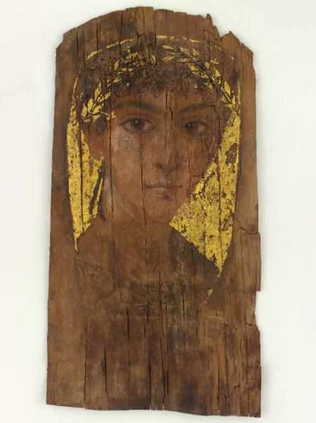
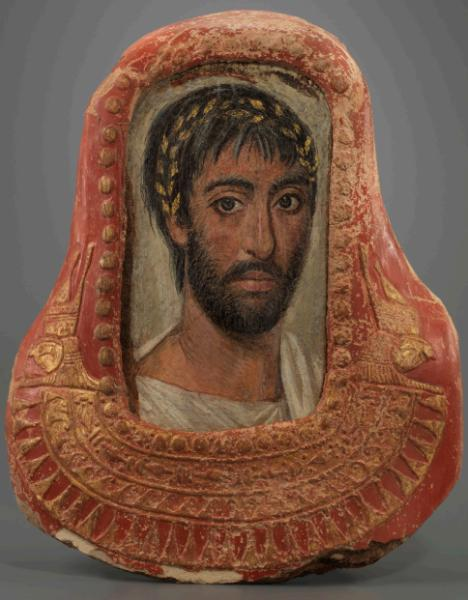

---

title: Retratos

---

Estamos en la Base de Datos del sistema. En la página se lista una breve referencia de cada uno de los retratos que ya están incluidos en ella: fotografía, nombre, denominación, dónde se encuentra (con número de catálogo) y localización. 

Por medio de sus enlaces, accederán a una ficha completa de cada retrato, con información sobre museología, retratística, complementos, sociología, bibliografía y relaciones. Estos datos se irán completando progresivamente.

| Retrato | Datos |
| --- | --- |
|  | **[[Pad001\|Pad001]]** **Retrato de señora sobre madera con restos de enfardado** **Se encuentra en:** Colección privada **Localización:** Desconocida |
|  | **[[Pad002\|Pad002]]** **Joven con mechón juvenil, corona y fondo dorado** **Se encuentra en:** Bowdoin College Museum of Art (2015.38) **Localización:** Brunswick, Maine (ME) / EE. UU |
|  | **[[Pad003\|Pad003]]** **Hombre de rostro alargado encastrado en un cartonnage** **Se encuentra en:** Girton College, The Lawrence Room (LR.1) **Localización:** Cambridge, Reino Unido |