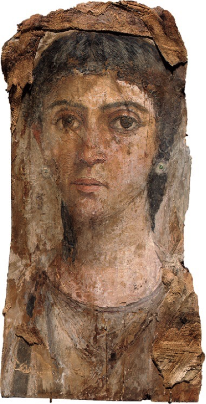
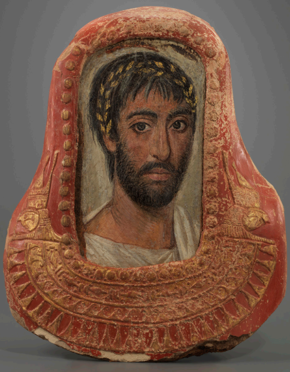

---

title: Retratos

---

Estamos en la Base de Datos del sistema. En la página se lista una breve referencia de cada uno de los retratos que ya están incluidos en ella: Nombre del ejemplar, una fotografía y su localización (núm. cat.), ciudad, país. 

Por medio de sus enlaces, accederán a una ficha completa de cada retrato, con información sobre museología, retratística, complementos, sociología, bibliografía y relaciones. Estos datos se irán completando progresivamente.

| Retrato | Datos |
| --- | --- |
|  | **[[PI0001\|PI0001]]** **Ubicación:** Colección privada **Localización:** Desconocida |
|  | **[[PI0003\|PI0003]]** **Ubicación:** Bowdoin College Museum of Art (2015.38) **Localización:** Brunswick, Maine (ME) / EE. UU |
|  | **[[PI0003\|PI0003]]** **Ubicación:** Girton College, The Lawrence Room (LR.1) **Localización:** Cambridge, Reino Unido |