---

title: Retratos

---

En esta página se lista una breve referencia de cada uno de los ejemplares que ya están incluidos en el sistema: fotografía, nombre, y algunos datos básicos.

Por medio de sus enlaces, accederán a una ficha de cada retrato, en la que siempre se hallará información completa de la colección que lo custodia, así como una valoración inicial somera de la obra. Muchos más datos adicionales sobre museología, retratística, complementos, sociología... se irán completando progresivamente.

|Retrato|Datos|
|-|-|
|[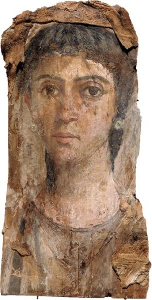](Seccion-retratos/Pad001.md)|**[[Pad001\|Pad001]]** ─ **Señora sobre madera en tonos pastel, con restos de enfardado**
Ubicación:Colección privadaGénero y procedencia:Mujer de procedencia desconocidaTécnica y soporte:A la encáustica sobre madera
|
|[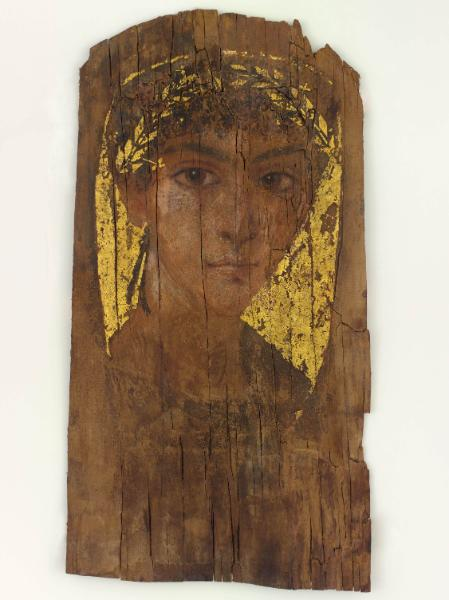](Seccion-retratos/Pad002.md)|**[[Pad002\|Pad002]]** ─ **Joven con mechón juvenil, corona y fondo dorado**
Ubicación:Bowdoin College Museum of ArtGénero y procedencia:Hombre de procedencia desconocidaTécnica y soporte:A la encáustica sobre madera de tilo
|
|[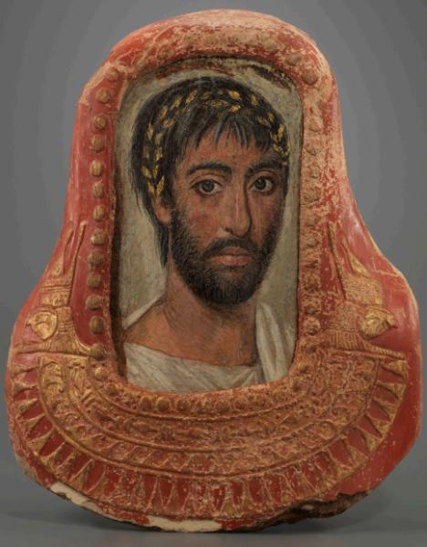](Seccion-retratos/Pad003.md)|**[[Pad003\|Pad003]]** ─ **Hombre de rostro alargado encastrado en un cartonnage**
Ubicación:Fondation Gadur pour l'ArtGénero y procedencia:Hombre de procedencia desconocidaTécnica y soporte:A la encáustica sobre madera
|
|[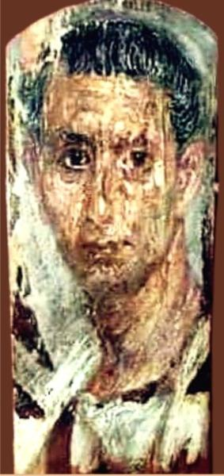](Seccion-retratos/Pad004.md)|**[[Pad004\|Pad004]]** ─ **Adulto con el cuerpo de perfil**
Ubicación:Kom Aushim MuseumGénero y procedencia:Hombre de procedencia desconocidaTécnica y soporte:Técnica indeterminada sobre madera
|
|[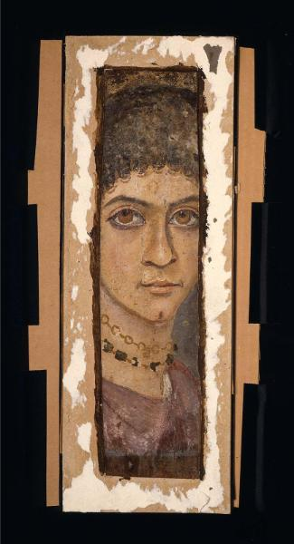](Seccion-retratos/Pad005.md)|**[[Pad005\|Pad005]]** ─ **Retrato de dama cortado en vertical**
Ubicación:Museum of Fine ArtsGénero y procedencia:Mujer de procedencia dudosaTécnica y soporte:A la témpera sobre madera
|
|[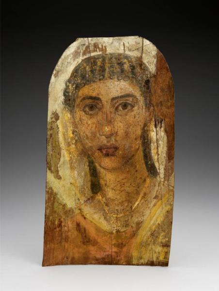](Seccion-retratos/Pad006.md)|**[[Pad006\|Pad006]]** ─ **Joven con peinado de melón y fondo dorado**
Ubicación:The Museum of Fine ArtsGénero y procedencia:Mujer de procedencia desconocidaTécnica y soporte:A la encáustica sobre madera
|
|[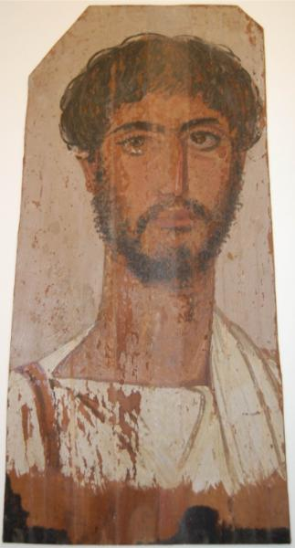](Seccion-retratos/Pad007.md)|**[[Pad007\|Pad007]]** ─ **Hombre de frente con pelo ondulado, bigote y barba**
Ubicación:Rijksmuseum van OudhedenGénero y procedencia:Hombre de procedencia desconocidaTécnica y soporte:Técnica indeterminada sobre madera
|
|[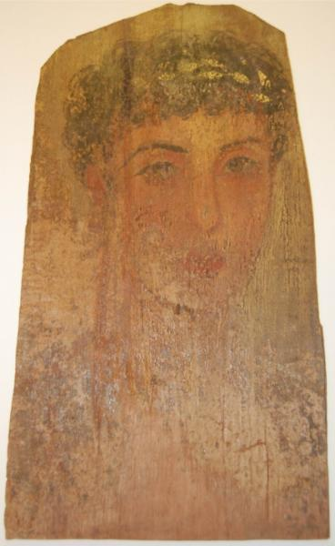](Seccion-retratos/Pad008.md)|**[[Pad008\|Pad008]]** ─ **Niño con corona girado a la izquierda con vestidura imperceptible**
Ubicación:Rijksmuseum van OudhedenGénero y procedencia:Hombre de procedencia desconocidaTécnica y soporte:Técnica indeterminada sobre madera
|
|[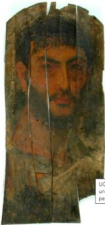](Seccion-retratos/Pad009.md)|**[[Pad009\|Pad009]]** ─ **Hombre de rostro anguloso y flequillo a virgola**
Ubicación:Petrie Museum of Egyptian ArchaeologyGénero y procedencia:Hombre procedente de HawaraTécnica y soporte:A la encáustica sobre madera de tilo
|
|[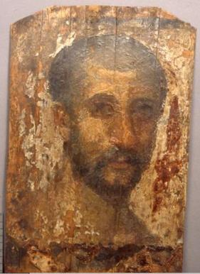](Seccion-retratos/Pad010.md)|**[[Pad010\|Pad010]]** ─ **Hombre de torso desnudo con entradas, girado a la izquierda**
Ubicación:Petrie Museum of Egyptian ArchaeologyGénero y procedencia:Hombre procedente de HawaraTécnica y soporte:A la encáustica sobre madera de tilo
|
|[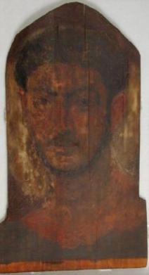](Seccion-retratos/Pad011.md)|**[[Pad011\|Pad011]]** ─ **Hombre de rostro rectangular y vestiduras sin pintar**
Ubicación:Petrie Museum of Egyptian ArchaeologyGénero y procedencia:Hombre procedente de HawaraTécnica y soporte:A la encáustica sobre madera de tilo
|
|[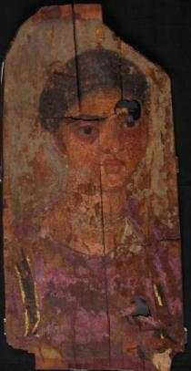](Seccion-retratos/Pad012.md)|**[[Pad012\|Pad012]]** ─ **Mujer con un pasador dorado**
Ubicación:Petrie Museum of Egyptian ArchaeologyGénero y procedencia:Mujer procedente de HawaraTécnica y soporte:A la encáustica sobre madera de tilo
|
|[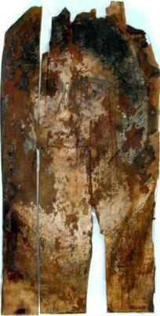](Seccion-retratos/Pad013.md)|**[[Pad013\|Pad013]]** ─ **Mujer joven de Hawara en pésimo estado**
Ubicación:Petrie Museum of Egyptian ArchaeologyGénero y procedencia:Mujer procedente de HawaraTécnica y soporte:A la encáustica sobre madera
|
|[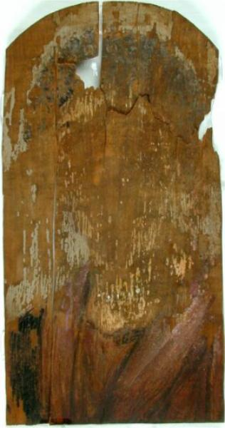](Seccion-retratos/Pad014.md)|**[[Pad014\|Pad014]]** ─ **Retrato de mujer con orario**
Ubicación:Petrie Museum of Egyptian ArchaeologyGénero y procedencia:Mujer procedente de HawaraTécnica y soporte:A la encáustica sobre probable madera de tilo
|
|[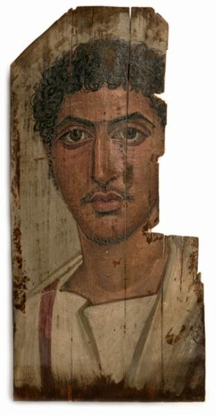](Seccion-retratos/Pad015.md)|**[[Pad015\|Pad015]]** ─ **Panel con el tercio superior derecho perdido**
Ubicación:Manchester Museum, The University of ManchesterGénero y procedencia:Hombre de procedencia desconocidaTécnica y soporte:A la encáustica sobre madera
|
|[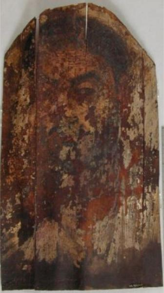](Seccion-retratos/Pad016.md)|**[[Pad016\|Pad016]]** ─ **Hombre apenas visible con ceja circunfleja**
Ubicación:Petrie Museum of Egyptian ArchaeologyGénero y procedencia:Hombre procedente de HawaraTécnica y soporte:A la encáustica sobre madera de tilo
|
|[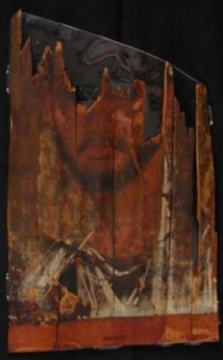](Seccion-retratos/Pad017.md)|**[[Pad017\|Pad017]]** ─ **Panel con la cuarta parte superior perdida**
Ubicación:Petrie Museum of Egyptian ArchaeologyGénero y procedencia:Hombre procedente de HawaraTécnica y soporte:A la encáustica sobre madera de tilo
|
|[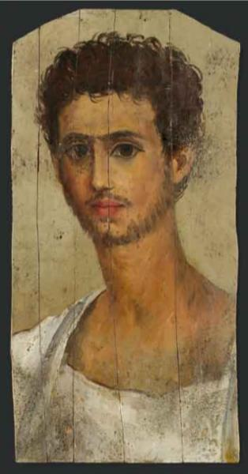](Seccion-retratos/Pad018.md)|**[[Pad018\|Pad018]]** ─ **Joven de pelo rizado y largo cuello**
Ubicación:Colección privadaGénero y procedencia:Hombre de procedencia desconocidaTécnica y soporte:Técnica mixta (encáustica/témpera) sobre madera
|
|[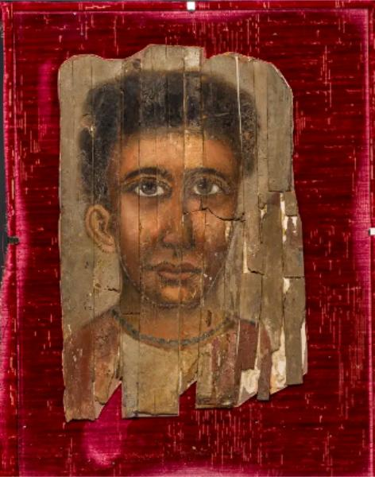](Seccion-retratos/Pad019.md)|**[[Pad019\|Pad019]]** ─ **Retrato de joven sobre un tapete rojo**
Ubicación:Colección privadaGénero y procedencia:Hombre de procedencia desconocidaTécnica y soporte:A la encáustica sobre madera
|
|[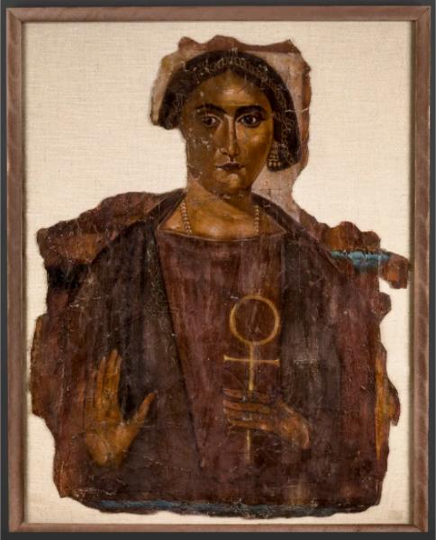](Seccion-retratos/Pad020.md)|**[[Pad020\|Pad020]]** ─ **Sudario de dama con ankh**
Ubicación:Colección privadaGénero y procedencia:Mujer procedente de AntinoópolisTécnica y soporte:A la encáustica sobre lino
|
||**[[PI0162\|PI0162]]** ─ **El joven Artemidoros en su momia**
Ubicación:British MuseumGénero y procedencia:Hombre procedente de HawaraTécnica y soporte:A la encáustica sobre madera
|
|[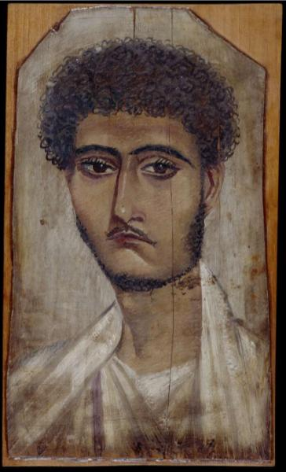](Seccion-retratos/PI0194.md)|**[[PI0194\|PI0194]]** ─ **Joven con hemiatrofia facial progresiva a la derecha**
Ubicación:British MuseumGénero y procedencia:Hombre procedente de HawaraTécnica y soporte:A la encáustica sobre madera de tilo
|
|[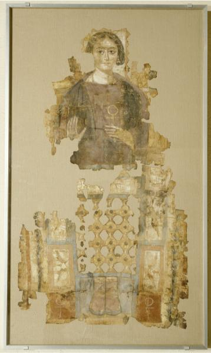](Seccion-retratos/PII0419.md)|**[[PII0419\|PII0419]]** ─ **Sudario de Crispina**
Ubicación:Musée du LouvreGénero y procedencia:Mujer procedente de AntinoópolisTécnica y soporte:A la témpera sobre lino
|
|[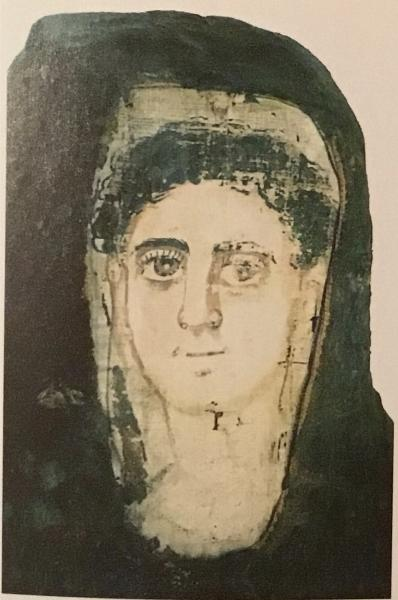](Seccion-retratos/PIV0748.md)|**[[PIV0748\|PIV0748]]** ─ **Retrato en su momia pintado sobre papiro**
Ubicación:Kom Aushim MuseumGénero y procedencia:Hombre procedente de Deir el-BanatTécnica y soporte:A la témpera sobre papiro
|
|[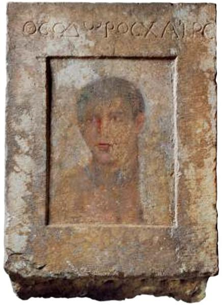](Seccion-retratos/Rad001.md)|**[[Rad001\|Rad001]]** ─ **Retrato sobre estela en piedra**
Ubicación:Archaeological Museum of ThebesGénero y procedencia:Hombre procedente de Tebas (Beocia, Grecia)Técnica y soporte:Técnica indeterminada sobre piedra
|
|[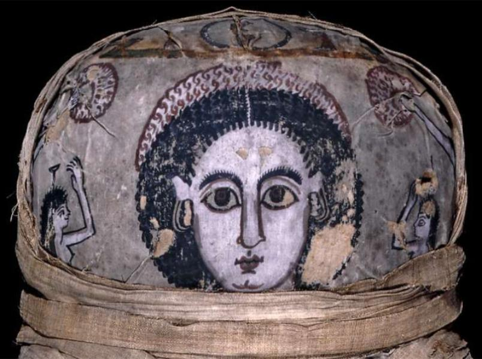](Seccion-retratos/Rad002.md)|**[[Rad002\|Rad002]]** ─ **Imagen de Cleopatra, no individualizada, sobre lino**
Ubicación:British MuseumGénero y procedencia:Mujer procedente de TebasTécnica y soporte:Técnica indeterminada sobre lino
|

