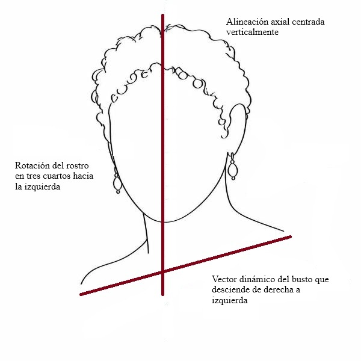

# Retratística

### Descripción
<u>I) Edad</u>. [[Edades|Adulta]], [[Agrupaciones|entre 36-50 años, agrupación ED11]]. Si la estela la refiere a ella y la edad es correcta (no tiene por qué serlo, conocemos papiros sobre personas a las que se adjudica edades diferentes en el mismo documento), Aline está justo en la frontera entre la juventud y la edad adulta, hemos preferido clasificarla en este segundo grupo.

<u>II) Busto</u>. La mujer con el busto vuelto a su derecha, nos entrega la cabeza ligeramente en 3/4, apenas girada su vertical también hacia ese mismo lado; [[Rostros|rostro]] de forma redondeada, que remata en una barbilla apenas destacada por la sombra del labio inferior y una mancha en tonos ocre ([[Agrupaciones|agrupación RF10]]).

<u>III) Cabello/frente y orejas</u>. [[Frentes|Frente tipo arco en mitra]], interrumpido por elegantes caracoles que sobresalen de un pelo negro, con manchas grises, y levemente ondulado. La rotación de la cabeza no deja vislumbrar más que la oreja izquierda que, redondeada, presenta una clara diferencia pictórica entre el caracol y la hélice, frente al lóbulo que parece sin terminar.

<u>IV) Ojos</u>. Cejas arqueadas, espesas y anchas que casi se unen en el entrecejo, con pestañas marcadas en trazos negros pequeños y gruesos, sobre unos preciosos ojos verdes, almendrados, que miran de frente al espectador ([[Agrupaciones|agrupación MI02]]), pero sin fijarlo (el “punto de la vida” se ha desplazado del centro evitando esa mirada directa), como también se ha evitado una esclerótica blanca amenazante. El párpado inferior extiende sus tonos rosados hacia los pómulos, transmitiendo, quizás, una sensación de llanto que se contiene.

<u>V) Nariz y boca</u>. La nariz recta y ancha con las fosas nasales disparejas que, como en el caso del [[PI0034]], llaman la atención de Dioxiadis (2000, p. 64) a quien le recuerda algunos retratos de Francis Bacon; boca algo pequeña, cerrada, con labios separados por una fina línea negra en forma de "badén", de color rosa violeta intenso y un arco de Cupido muy abierto. Ningún rastro de sonrisa.

<u>VI) Cuello</u>. [[Cuellos|Tipo toro]], ancho y corto, donde es visible una crecida papada.

<u>VII) Carnación</u>. Dice Doxiadis (2000, p. 200) que es de tonos rojo bronce, con algunas zonas claras. Creo justo destacar los amplios campos de rosa sobre los pómulos.

<u>VIII) Consideraciones generales (*[[Consideraciones|vid.]]*)</u>. Estamos ante la representación de una dama mediterránea de la que ha querido destacarse, sobre todo, su rostro, de un tamaño sobresaliente respecto de la parte superior del tronco que se dibuja. El resultado muestra la obra de un gran artista que, con una técnica simple, ha conseguido un magnífico logro de presencia física, serenidad y orgullo.

### Técnica, materiales y procedimientos
**I) Técnica.**

a) Témpera sobre lino de 42 x 33 x 2 cm (MR). Doxiadis (2000, p. 200) y Parlasca (1999, p. 63) dan una altura ligeramente diferente: 42.5 cm.

b) La témpera ([[tempera|v. artículo]]), o el temple, sustantivos que consideraremos sinónimos, es una técnica pictórica que emplea una emulsión de componentes grasos y acuosos, esto es, el pigmento se disuelve en agua y se le añade un aglutinante graso como, por ejemplo, las colas animales, las gomas vegetales o el huevo. Las características esenciales que de ella nos interesan pueden resumirse así: se seca demasiado rápido para poder mezclar colores; no puede ser aplicada en capas gruesas, sino, al contrario, debe hacerse en capas finas, semi-opacas o transparentes; rara vez tiene la profundidad de color que puede alcanzar la encáustica; produce un acabado fino y mate; y sus colores no cambian a lo largo del tiempo.

**II) Materiales.**

<u>a) Imprimación</u>. El soporte no fue aparejado (Donner, 1893, p. 2).

<u>b) Pigmentos</u>. No conocemos un estudio que detalle este aspecto de la tela. 

<u>c) Decoración</u>. Debe destacarse que tanto los engarces de los pendientes, como el collar, están realizados con estuco y recubiertos con pan de oro.

**III) Procedimientos.**

<u>a) Aparejo</u>. Como hemos referido, el soporte no fue aparejado. 

<u>b) Boceto</u>. No hay noticias de ningún boceto o dibujo preliminar.

(V. figura 1: Esquema geométrico C. Elaboración propia).

<u>c) Composición</u>. La definiremos como un esquema geométrico C ([[Agrupaciones|agrupación GEC]]): rostro vertical centrado en la composición y girado en tres cuartos hacia la izquierda, sincronizado con una diagonal inferior descendente de derecha a izquierda. El personaje está desplazado hacia ese lado superior, donde parece que puede desbordar el marco, apoyando la línea de fuerza oblicua. En nuestra opinión, este diseño, lejos de ser casual, y atender a criterios pictóricos relacionados con el *[[contrapposto]]*, podría tener un componente mágico-religioso: proyecta la esperanza de un movimiento que se correspondería con el lapso pasado-futuro.

<u>d) Fondo</u>. El fondo acentúa el desplazamiento de Aline con una absoluta diferencia tonal entre su derecha (pasado), tono más oscuro, y su izquierda (futuro), sensiblemente más claro ([[Agrupaciones|agrupación FO03]]). Lo curioso es que ese tratamiento del fondo ha invadido al personaje, en lo que a su vestimenta se refiere, produciéndose una destacable disonancia entre luz del rostro y luz del fondo. Dice Doxiadis (2000, pp. 64 y 200) que este retrato sobresale, entre los realizados a la témpera, por tener un fondo coloreado (marrón claro debajo de la carne y gris negruzco en otras partes) en vez del habitual blanco.

<u>e) Luz</u>. La luz entra desde su izquierda y produce sombras propias evidentes en la nariz, sobre el labio superior y bajo el inferior, en el cuello y en la parte derecha del rostro. Es una fuente dura y contrastante como demuestran los puntos de luz en la frente y, sobre todo, en el lóbulo de la nariz, además de blanquear el cuello de Aline.

<u>f) Color</u>. En la eterna disputa pictórica entre el dibujo y el color, en este caso no hay rastro del primero y el segundo domina la composición. Con él se han creado las formas y el retrato. Solo una leve excepción confirma este aserto: la línea oscura que separa la mandíbula derecha de Aline respecto del fondo claro. El predominante tono broncíneo del rostro, con las amplias zonas rosas, aportan una calidez que domina la escena y contrasta, de manera chocante, con un fondo frío y desangelado que nos acerca aún más a la efigiada.

<u>g) Pincelada</u>. Recurrimos al fino análisis de Otto Donner von Richter. Se utilizó un pincel ancho y suave para ejecutar los amplios campos de color: las luces, los tonos intermedios y las sombras, fundiéndolos entre sí para lograr, en términos generales, el volumen y la plasticidad de la cabeza. A partir de ese punto, el artista utilizó un pincel de punta fina, manejado con ligereza, para animar y enriquecer los tonos principales mediante un tramado de trazos más claros o intensos allí donde lo necesita o, al contrario, trazos más oscuros para acentuar las sombras propias y las zonas de mayor profundidad, como ocurre, por ejemplo, en las cejas (Donner, 1893, p. 2).Este planteamiento de Otto Donner se corresponde exactamente con la técnica de la témpera.

<u>h) Detallismo</u>. También en este soberbio ejemplar se comprueba que los detalles pierden nitidez a medida que se alejan del centro del rostro. Es un pormenor del mayor interés, no ya pictórico, sino social que, en nuestra opinión, viene a abundar (junto a otros datos) en que estos retratos carecían de un interés social ostentatorio. Aunque es imposible generalizar y el alarde está mucho menos claro en bastantes retratos femeninos. Aquí, la vestimenta, un excelente medio de comunicación no verbal, casi se ha obviado frente, eso sí, al realce dado a la joyería.

<u>i) Realismo/esquematismo</u>. La obra es naturalista individualizada (el hiperrealismo no existía hace dos mil años). Jamás podremos saber si el artista idealizó, suavizó o, quizás, acentuó algún rasgo de su comitente, pero resulta manifiesto que la efigiada que vemos en una señora única.

