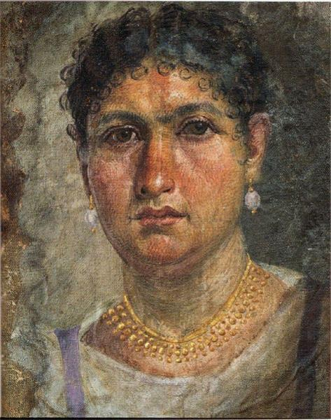

<h3>Bibliografía</h3>

MR = <a href="https://smb.museum-digital.de/object/521">Ägyptisches Museum und Papyrussammlung-retrato</a>

<a href="../bibliografia#^c142b3">Parlasca, 1969</a>

<a href="../bibliografia#^caca01">Parlasca & Frenz, 2003</a>

<a href="../bibliografia#^32f8ca">Bernand, 1975</a>

<a href="../bibliografia#^4bead9">Borg, 1998</a>

<a href="../bibliografia#^7db1c2">Donner von Richter, 1893</a>

<a href="../bibliografia#^83dc98">Doxiadis, 2000</a>

<a href="../bibliografia#^14294e">Erman, 1893</a>

<a href="../bibliografia#^e92581">Königliche Museen zu Berlin, 1899</a>

<a href="../bibliografia#^b7a83c">The Packard Humanities Institute, 2023</a>

<a href="../bibliografia#^79791d">Vaughan, <i>et al.</i>, 1892</a>

[[Bibliografia#^89df73|Worp, & Dekker, 2016]]

<h3>Valoración</h3>

Ägyptisches Museum und Papyrussammlung (ÄM 11411), Berlín, Alemania

***

Este primer ejemplo de pintura sobre lino, bien conocido y número uno del <i>Repertorio</i> de Parlasca, nos permite una breve reflexión al respecto. Como en todos los retratos que utilizan este soporte, lo primero a destacar es ese efecto, casi puntillista, que la trama de la tela ha provocado en el resultado final de la obra.

La segunda cuestión importante, que afecta a uno de los debates primigenios e inacabados, es ¿cuándo se pintaron estos retratos? Aquí no cabe ninguna duda: está realizado directamente sobre la mortaja que envolvía al cuerpo y, por tanto, hecho una vez que la dama estaba muerta.
Sin embargo, apunta Parlasca que, «los rasgos altamente expresivos de la pintura, que sobre la base del examen del hallazgo se llevan a cabo póstumamente, indican que es una copia de un retrato más antiguo» (Parlasca, 1969, p. 25). El profesor alemán no explica las razones de esta conclusión, salvo la desconfianza en las facultades de los artistas para ser capaces de captar la vitalidad de sus comitentes a partir de un cadáver. Aunque no se trata de una deducción científica, sino de un “parecer”, un “sentir”, es obligatorio tomar muy en serio la opinión de tal autoridad. Según esta tesis, que también suscribe Euphrosyne Doxiadis (2000, p. 64), otro especialista muy respetado, la obra es copia de una previa realizada en vida de la ahora difunta, y sería el retrato de un retrato. La idea plantea graves cuestiones de entidad. ¿No es una teoría peregrina, basada en un frágil escepticismo? ¿Todos los retratos sobre sudarios son, entonces, copias de cuadros previos? ¿También se habían hecho apuntes anteriores de los dos “hijos”, casi bebés, de Alina que le acompañaban en la tumba? ¿Y las muestras que tenemos de personas ya ancianas, se realizaban de ellas dibujos periódicos para, al fin, plasmar la imagen más reciente del decesado? ¿Por qué hacer la copia de un original y no incluir sin rodeos el primero?

En todo caso, estas preguntas no finiquitan la cuestión y las dudas sobre cuándo se pintaban los retratos son abundantes, con opiniones variadas. Lo cierto es que entre el fallecimiento y la pintura quizás pudieron pasar hasta dos meses y este hecho también requiere una explicación. Sabemos, por ejemplo, aunque sin pruebas directas, que existían retratos en las casas, lo cual mantiene abierta la incertidumbre.

<nav class="ficha-apartados">
<button type="button" class="boton-papiro" data-estudio="museologia">Museología</button><button type="button" class="boton-papiro" data-estudio="retratistica">Retratística</button><button type="button" class="boton-papiro" data-estudio="complementos">Complementos</button><button type="button" class="boton-papiro" data-estudio="sociologia">Sociología</button>
</nav>

