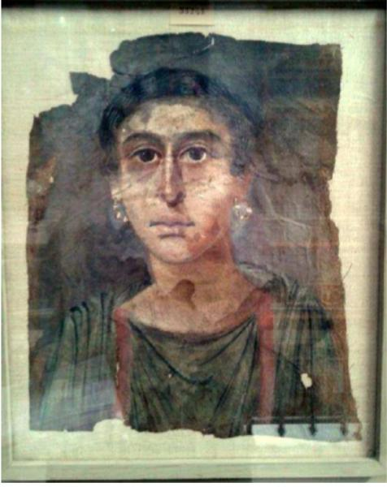

<h3>Bibliografía</h3>

<a href="../bibliografia#^2e7a13">Mohammed & Ibrahim, 2016</a>

<h3>Previo</h3>

Egyptian Museum (CG33268), El Cairo, Egipto

***

<nav class="ficha-apartados">

<button type="button" class="boton-papiro" data-estudio="museologia">Museología</button>

<button type="button" class="boton-papiro" data-estudio="retratistica">Retratística</button>

<button type="button" class="boton-papiro" data-estudio="complementos">Complementos</button>

<button type="button" class="boton-papiro" data-estudio="sociologia">Sociología</button>
<button type="button" class="boton-papiro" data-estudio="agrupaciones">Agrupaciones</button>

</nav>

