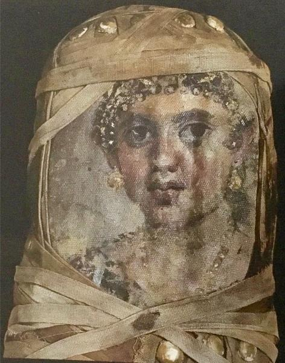

<h3>Bibliografía</h3>

MR = <a href="https://search.smb.museum/object/obj-607541">Ägyptisches Museum und Papyrussammlung-retrato</a>

<a href="../bibliografia#^c142b3">Parlasca, 1969</a>

<a href="../bibliografia#^caca01">Parlasca & Frenz, 2003</a>

<a href="../bibliografia#^e92581">Königliche Museen zu Berlin, 1899</a>

<h3>Valoración</h3>

Ägyptisches Museum und Papyrussammlung (ÄM 11412), Berlín, Alemania

***

Este primer ejemplo de pintura sobre lino, bien conocido y número uno del <i>Repertorio</i> de Parlasca, nos permite una breve reflexión al respecto. Como en todos los retratos que utilizan este soporte, lo primero a destacar es ese efecto, casi puntillista, que la trama de la tela ha provocado en el resultado final de la obra.

<nav class="ficha-apartados">
<button type="button" class="boton-papiro" data-estudio="museologia">Museología</button><button type="button" class="boton-papiro" data-estudio="retratistica">Retratística</button><button type="button" class="boton-papiro" data-estudio="complementos">Complementos</button><button type="button" class="boton-papiro" data-estudio="sociologia">Sociología</button>
</nav>

