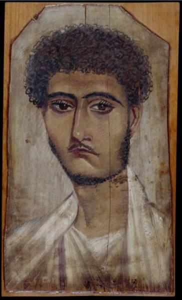

<h3>Bibliografía</h3>

MR = <a href="https://www.britishmuseum.org/collection/object/Y_EA74707">British Museum-retrato</a>

<a href="../bibliografia#^8a07ea">Appenzeller <i>et al.</i>, 2001</a>

<h3>Valoración</h3>

Bristish Museum (EA74707), Londres, Reino Unido

***

Es evidente que es rasgo destacable de este retrato es el descubrimiento de que padecía una enfermedad neurológica.

En 2001 un estudio de paleoneurología clínica sobre este joven, que tenía un cráneo asociado, le diagnosticó hemiatrofia facial, demostrando que el pintor ejecutó una perfecta realidad (Appenzeller <i>et al.</i>, 2001, pp. 528-529).

Entre otros retratos, que se han señalado en cada caso, este ejemplo no solo viene a demostrar la capacidad técnica de ese artista, o su intención de plasmar la individualidad del comitente, sino que subraya algo mucho más importante: la ruptura absoluta con la tradición egipcia de representar a sus muertos.

<nav class="ficha-apartados">
<button type="button" class="boton-papiro" data-estudio="museologia">Museología</button><button type="button" class="boton-papiro" data-estudio="retratistica">Retratística</button><button type="button" class="boton-papiro" data-estudio="complementos">Complementos</button><button type="button" class="boton-papiro" data-estudio="sociologia">Sociología</button>
</nav>

