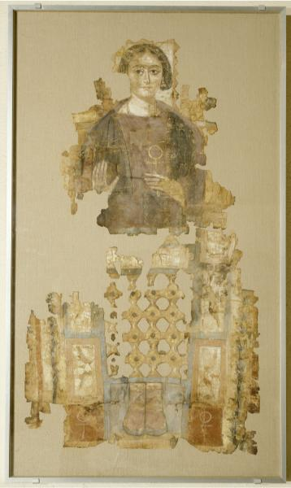

<h3>Bibliografía</h3>

MR = <a href="https://collections.louvre.fr/ark:/53355/cl010048708">Musée du Louvre-retrato</a>

<a href="../bibliografia#^90951d">Parlasca, 1977</a>

<a href="../bibliografia#^caca01">Parlasca & Frenz, 2003</a>

<a href="../bibliografia#^26625d">Aubert, 2008</a>

<a href="../bibliografia#^642328">Nachtergael, 2008</a>

<h3>Valoración</h3>

Musée du Louvre (AF 6440), París, Francia

***

El sudario de Crispina es uno de esos ejemplos que se encuentra en la frontera entre individualización y estereotipo. Hemos dudado bastante si sacarlo fuera del corpus, porque resulta evidente que estamos ante un modelo que se repite: [[PII0415]], [[PII0416]], [[PII0417]], [[PII0418]], [[PII0420]] y, quizás sobre todo, en el [[Pad020]], aunque es cierta la existencia de detalles que nos han inducido a considerar estos retratos como individualizados. No nos referimos a particularidades, importantes pero, accesorias como ligeras variaciones en el peinado, las joyas que atavían a las comitentes o la posición y contenido de las manos; observamos rasgos fisionómicos diferenciales, en unos casos más evidentes que en otros, para sostener, con dudas, nuestra elección.

La única forma de solventar un problema fronterizo como este, sería el estudio directo y a la vez de los ejemplaresmás próximos, porque incluso las fotografías de calidad resultan engañosas.

<nav class="ficha-apartados">

<button type="button" class="boton-papiro" data-estudio="museologia">Museología</button>

<button type="button" class="boton-papiro" data-estudio="retratistica">Retratística</button>

<button type="button" class="boton-papiro" data-estudio="complementos">Complementos</button>

<button type="button" class="boton-papiro" data-estudio="sociologia">Sociología</button>

</nav>

