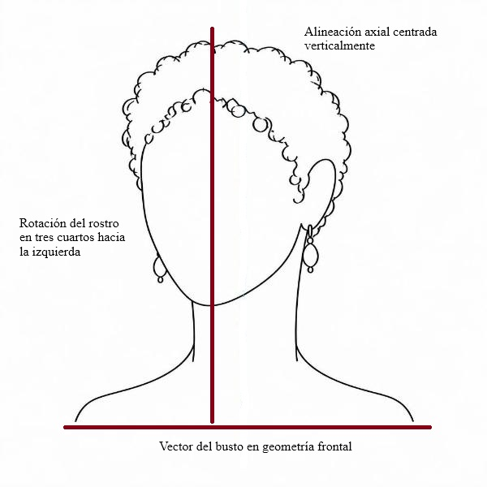

# Retratística

### Descripción 
<u>I) Edad</u>. [[Edades|Adolescente]] entre 15-20 años. 

<u>II) Busto</u>. Apenas visible para determinar su orientación, con la cabeza en 3/4, girada a su derecha y verticalmente recta; el rostro tiene forma claramente [[Rostros|adiamantada]], presentando una mandíbula no marcada que termina en un mentón alargado y afilado. No se aprecia la asimetría facial tan característica en bastantes retratos.

<u>III) Cabello/frente y orejas</u>. El pelo negro, corto y liso conforma una frente [[Frentes|tipo arco carpanel]], que define un espacio estrecho pero limpio. El peinado (más la rotación del busto) no deja vislumbrar apenas nada de las orejas.

<u>IV) Ojos</u>. Cejas anchas, arqueadas y largas, bien cuidadas, junto a pestañas muy ligeramente perceptibles solo en el ojo derecho, enmarcan hendiduras palpebrales grandes y almendradas; ojos algo caídos, con la “mirada de las 2000 yardas”, carentes de punto blanco en la pupila (el denominado “punto de la vida”). Los párpados superiores aparecen pesados y caídos, mientras que los inferiores se adivinan enrojecidos, y los pómulos no se han destacado.

<u>V) Nariz y boca</u>. Larga y recta, con lóbulos abiertos, la primera, se une a la boca por un surco nasolabial apenas marcado y sin surcos nasogenianos. Esta se ha representado cerrada, corta y pequeña, con un pliegue comisural marcado por una gran línea negra recta; elegantes labios de tonos rosados y el arco de Cupido apenas relevante. En conjunto, la boca ofrece una serenidad y abstracción de excesos que refuerza el conjunto.

<u>VI) Cuello</u>. [[Cuellos|Tipo tubular]].

<u>VII) Carnación</u>. Tonos cálidos de tez mediterránea con pocas florituras.

<u>VIII) Consideraciones generales (*[[Consideraciones|vid.]]*)</u>. La obra presenta una coherencia cromática absoluta y una belleza serena imponente. Todos los detalles que se han ido enumerando abundan en una declaración sin estridencias, en un excelso tratamiento pictórico que acompaña una imagen trágica y calma a la vez.

### Técnica, materiales y procedimientos 
**I) Técnica.** 

a) Encáustica (cera como aglutinante) sobre madera desconocida de 39.6 cm (Christie's 2006).

b) La encáustica ([[encaustica|v. artículo]]) es una técnica pictórica que utiliza la cera fundida como aglutinante de los pigmentos. A veces se añaden pequeñas cantidades de resinas naturales, para conferir mayor dureza, o aceites, para facilitar su manipulación. Debe aplicarse en caliente con pincel o espátula y, al enfriarse, se endurece y queda fundida sobre la superficie.

**II) Materiales.**

<u>a), b), c)</u> Carecemos de informaciones relativas a imprimación, pigmentos o decoraciones especiales aplicadas a esta obra.

**III) Procedimientos.**

<u>a), b)</u> Sin noticias sobre la existencia de aparejo o boceto preparatorio en este panel.

(V. figura 1: Esquema geométrico 03. Elaboración propia).

<u>c) Composición</u>. Con el estrecho marco que sobrevive del retrato es difícil extraer conclusiones. Da la impresión de ofrecernos un esquema geométrico que definiremos como 03 ([[Agrupaciones|agrupación GE03]]): rostro vertical centrado en la composición y girado en tres cuartos hacia la izquierda, acompañado con una postura frontal de los hombros. Este diseño debe atender a criterios pictóricos en exclusiva, donde la cabeza marca un ligero *[[contrapposto]]* respecto del busto.

<u>d) Fondo</u>. Para Christie’s (2006), es de tono crema visible hoy apenas, aunque encajaría perfectamente con la tonalidad general de la obra. Como en el caso de la composición, también aquí parecen existir solo connotaciones pictóricas.

<u>e) Luz</u>. Una luz lateral contrastada entra desde su izquierda, aunque las sombras propias han sido bastante obliteradas salvo, quizás, en el cuello. A la vez, la zona iluminada lo está, en apariencia, con clarados del mismo color adyacente.

<u>f) Color</u>. En la eterna disputa pictórica entre el dibujo y el color, en este caso no hay rastro del primero y el segundo domina la composición. Con él se han creado las formas y el retrato. Desconociendo los pigmentos utilizados en la obra, la impresión del resultado final apunta a una paleta bastante reducida, cuya mayor complejidad residiría en conseguir el tono tierra marrón en el que se han mimetizado incluso los restos de enfardado presentes. Una vez logrado, el pintor solo tuvo que aclarar más o menos la mezcla para establecer puntos de luz y volumen.

<u>g) Pincelada</u>. Es imposible, a la vista de la fotografía del catálogo de Christie's, afirmar algo coherente a este respecto, por mucho que la técnica empleada proporcione pistas sobre el método de trabajo.

<u>h) Detallismo</u>. Existen algunos detalles incoherentes en el resultado del trabajo que hemos señalado en sus campos respectivos; obviándolos, por tanto, nos queda la consabida atención centrada en el rostro que, en este caso, parece extenderse con cierta riqueza al tratamiento del peinado y los paños.

<u>i) Realismo/esquematismo</u>. La obra es naturalista individualizada (el hiperrealismo no existía hace dos mil años). Jamás podremos saber si el artista idealizó, suavizó o, quizás, acentuó algún rasgo de su comitente, pero resulta manifiesto que la efigiada que vemos en una señora única.

