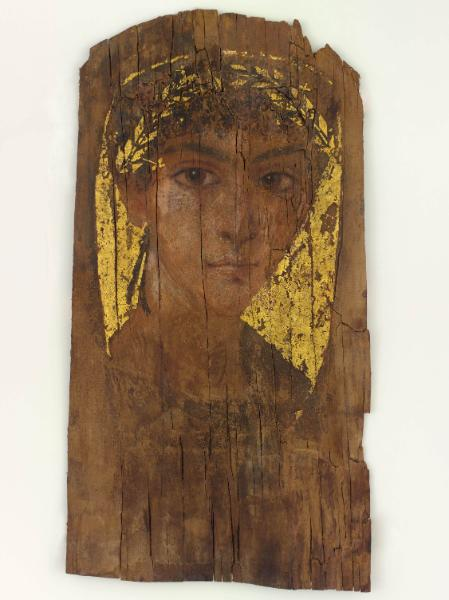

<h3>Bibliografía</h3>

MR = <a href="https://artmuseum.bowdoin.edu/objects-1/info/29520">Bowdoin College Museum of Art-retrato</a>

<a href="../bibliografia#^60c173">Bowdoin College Museum of Art, 2016</a>

<a href="../bibliografia#^528392">Christie’s London, 2015</a>

<a href="../bibliografia#^4fb9a2">Higginbotham, s. f.</a>
 

<h3>Valoración</h3>

Bowdoin College Museum of Art (2015.38), Brunswick, Maine (ME), EE. UU.

***

El personaje presenta las mismas dudas que otros retratos de individuos de esta edad, a los que es difícil asignar un sexo por su indeterminación fisiológica. Además, los elementos significativos de la representación son ambivalentes. El "mechón de juventud", que parecería el mejor indicador del sexo masculino, no está exento de objeciones o dudas. A un joven apunta también la ausencia de adornos personales. Sin embargo, el color del chitón nos inclinaría a pensar más en una niña. En las tres variables, no obstante, puede citarse algún ejemplo de ambos sexos.

Es destacable el amplísimo tramo inferior sin pintar de la tabla, más alto aquí que en la mayoría del corpus. Este hecho, significativo, dificulta la idea de una utilización anterior a su colocación sobre la momia.

<nav class="ficha-apartados">

<button type="button" class="boton-papiro" data-estudio="museologia">Museología</button>

<button type="button" class="boton-papiro" data-estudio="retratistica">Retratística</button>

<button type="button" class="boton-papiro" data-estudio="complementos">Complementos</button>

<button type="button" class="boton-papiro" data-estudio="sociologia">Sociología</button>

</nav>

