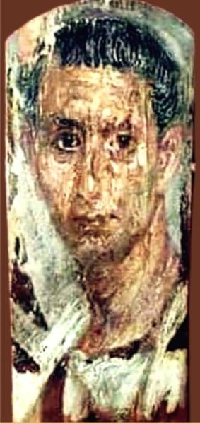

<h3>Bibliografía</h3>

<a href="../bibliografia#^996e63">Garzón Rodríguez, 2013</a>

<h3>Valoración</h3>

De este retrato solo conocemos la fotografía que, además, es poco fiable. Ni tan siquiera puestos en contacto con los responsables del museo ha sido posible obtener información adicional sobre el ejemplar.

A primera vista, la proporción 2.2 entre ancho y alto aparece como una de las características distintivas de esta obra, sustentada por la longitud del rostro y cuello del efigiado, que posa con un desmesurado *contrapposto* (cuerpo prácticamente de perfil y cabeza girada al frente con un leve desplazamiento vertical en sentido contrario). Ambas circunstancias: proporción y escorzo, convierten al retrato en un ejemplo singular y avanzado del corpus.

Es interesante subrayar aquí que este pequeño museo posee otro ejemplo único entre los retratos de el-Fayum: <a href="../seccion-retratos/PIV0748">PIV0748</a>.

<nav class="ficha-apartados">
<button type="button" class="boton-papiro" data-estudio="museologia">Museología</button><button type="button" class="boton-papiro" data-estudio="retratistica">Retratística</button><button type="button" class="boton-papiro" data-estudio="complementos">Complementos</button><button type="button" class="boton-papiro" data-estudio="sociologia">Sociología</button>
</nav>

