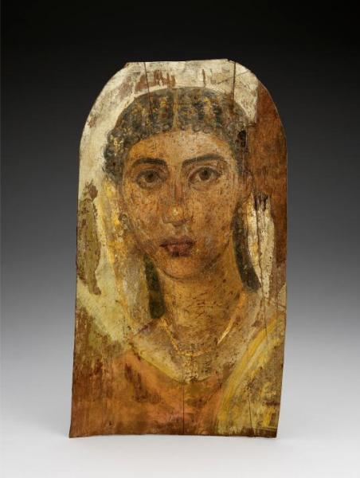

<h3>Bibliografía</h3>

MR = <a href="https://emuseum.mfah.org/objects/96231/mummy-portrait-of-a-young-woman?ctx=b4360e38d9720c6243580f5ca018aaac0382fdc2&idx=0#">The Museum of Fine Arts, Houston-retrato</a>

<h3>Valoración</h3>

El retrato tiene dos características aleatorias que acaban definiendo su estado actual: el corte final que ha resultado en la plancha y la pérdida casi absoluta del pan de oro aplicado como simbología final. Ambos detalles unidos le proporcionan una cierta sensación de movimiento fantasmagórico al espacio irreal del que sobresalta un rostro impertérrito de entre las brumas (gran mancha blanca superior, madera añadida a la derecha y pérdida de la capa pictórica inferior). 

Estas contingencias, sin duda aleatorias, se unen a la simple perfección que el artista supo infundir al joven rostro de su comitente, dejándonos un retrato muy especial en el acervo del corpus.

<nav class="ficha-apartados">
<button type="button" class="boton-papiro" data-estudio="museologia">Museología</button><button type="button" class="boton-papiro" data-estudio="retratistica">Retratística</button><button type="button" class="boton-papiro" data-estudio="complementos">Complementos</button><button type="button" class="boton-papiro" data-estudio="sociologia">Sociología</button>
</nav>

