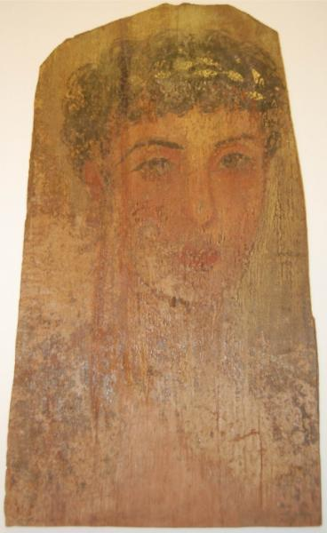

<h3>Bibliografía</h3>

MR = <a href="https://hdl.handle.net/21.12126/192">Rijksmuseum van Oudheden-retrato</a>

<a href="../bibliografia#^42df5d">Bercken & Kaper, Eds., 2023</a>

<h3>Valoración</h3>

Las fotografías de esta obra que proporciona el museo no le hacen justicia, aunque es cierto que el tercio inferior del retrato ha desaparecido. Pero se aprecian, no si dificultad, los rasgos elongados de un niño, quizás a punto de  pasar a la adolescencia, todavía imberbe y si más atavíos que la corona que justifica su pase a la eternidad.

<nav class="ficha-apartados">
<button type="button" class="boton-papiro" data-estudio="museologia">Museología</button><button type="button" class="boton-papiro" data-estudio="retratistica">Retratística</button><button type="button" class="boton-papiro" data-estudio="complementos">Complementos</button><button type="button" class="boton-papiro" data-estudio="sociologia">Sociología</button>
</nav>

