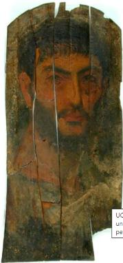

<h3>Bibliografía</h3>

Pendiente de incorporar.

<h3>Valoración</h3>

Como nos informa el museo, este retrato se ha reconstruido a partir de nueve piezas principales, más otros fragmentos, habiendo sufrido también un oscurecimiento general de la capa pictórica. Dicho lo cual, nos ha quedado la imagen potente de un rostro desafiante a pesar de los evidentes signos de enfermedad que reflejan sus hendiduras palpebrales. Influyen en la apariencia sus grandes rasgos (nariz, oreja, boca), su relevante bello facial (cejas y barba), más un peinado que podríamos calificar de estilo militar: corto y, quizás, algo descuidado.

<nav class="ficha-apartados">
<button type="button" class="boton-papiro" data-estudio="museologia">Museología</button><button type="button" class="boton-papiro" data-estudio="retratistica">Retratística</button><button type="button" class="boton-papiro" data-estudio="complementos">Complementos</button><button type="button" class="boton-papiro" data-estudio="sociologia">Sociología</button>
</nav>

