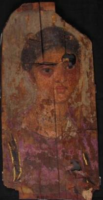

<h3>Bibliografía</h3>

MR = <a href="https://collections.ucl.ac.uk/Details/petrie/70887">Petrie Museum of Egyptian Archaeology-retrato</a>

<a href="../bibliografia#^0d703a">Adams & Walker, 2007</a>

<a href="../bibliografia#^49cfa9">Picton 2013</a>

<a href="../bibliografia#^225a1b">Picton, <i>et al.</i>, Eds., 2007</a>

<h3>Valoración</h3>

Petrie Museum of Egyptian Archaeology (LDUCE-UC38102), Londres, Reino Unido

***

A pesar de los daños apreciables, la dama efigiada puede considerarse una de las pertenecientes a la alta sociedad egipcia que optó por esta forma de representación, sin entrar en el uso de materiales de sustitución más baratos.

Chitón del color más caro posible: púrpura, <i>clavi</i> con bordes dorados, collar de esmeraldas, pendientes de perlas y un pasador, también dorado, en el cabello. Hemos escrito contra la asignación automática de los efigiados a clases pudientes, desde cualquier punto de vista, de la sociedad egipcia. También sabemos que colores, adornos y joyas podían, no ya falsificarse en la vida diaria, sino incluirse en los retratos cuando no existían. Sin embargo, es preciso reconocer que algunas imágenes de señoras deben analizarse en aquella dirección.

<nav class="ficha-apartados">
<button type="button" class="boton-papiro" data-estudio="museologia">Museología</button><button type="button" class="boton-papiro" data-estudio="retratistica">Retratística</button><button type="button" class="boton-papiro" data-estudio="complementos">Complementos</button><button type="button" class="boton-papiro" data-estudio="sociologia">Sociología</button>
</nav>

