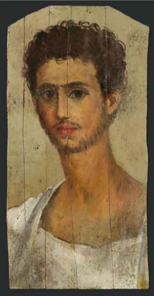

<h3>Bibliografía</h3>

<a href="../bibliografia#^595f8a">Pierre Bergé & associés, 2009</a>

<h3>Valoración</h3>

Colección privada

***

Volvemos a encontrarnos aquí con un retrato en excelente estado de conservación y, al tiempo, una corta biografía (en este caso inexistente: "antigua colección privada suiza") que nos hace sospechar: de su origen, de sus transferencias y de sus probables restauraciones.

Obviando estas vicisitudes, la obra está centrada en un largo cuello tubular que une dos partes inconexas. Por una lado el torso cubierto por un chitón con características reseñables: un <i>clavus</i> que alcanza el final de la tela en posición anormal, y cuyo escote se encuentra bordeado por una pequeña banda púrpura. Por otro, la cabeza y, sobre todo, esa hermosa mata de pelo rizado que en esta ocasión, no siempre es así ni mucho menos, el artista ha tratado con mimo.

El joven no llega a padecer de hemiatrofia, como sí le sucede al <a href="../seccion-retratos/pI0194">PI0194</a>, pero la perspectiva del rostro, levemente girado hacia la derecha, está mal resuelta.

<nav class="ficha-apartados">
<button type="button" class="boton-papiro" data-estudio="museologia">Museología</button><button type="button" class="boton-papiro" data-estudio="retratistica">Retratística</button><button type="button" class="boton-papiro" data-estudio="complementos">Complementos</button><button type="button" class="boton-papiro" data-estudio="sociologia">Sociología</button>
</nav>

