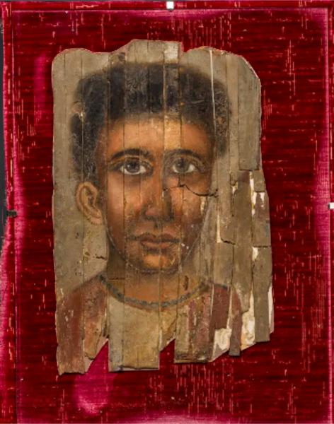

<h3>Bibliografía</h3>

<a href="../bibliografia#^de9c75">Barakat Gallery, 2026</a>

<h3>Valoración</h3>

Colección privada

***

El retrato se encuentra (noviembre de 2026) en la <a href="https://barakatgallery.eu/artworks/categories/954/71124-roman-period-egyptian-mummy-portrait-depicting-a-young-2nd-century-ce/">Barakat Gallery/a> de Londres</a>.

Muy desmejorado por la presentación sobre un tapete rojo intenso que menoscaba su imagen, no conocemos absolutamente ningún dato que pueda ayudarnos a vislumbrar su biografía.

Parece obvio que está lejos de ser uno de los mejores ejemplares del corpus, exponiendo una imagen simple del efigiado, con el abuso de sombras nada naturales. Esas sombras y el amplio volumen del cabello centran la atención de la pintura que, en todo caso, carece de interés al margen del busto, desde luego para el observador, pero de forma evidente para el artista. Y, sin embargo, el filete azulado que bordea el escote del chitón es un detalle realista que comentaremos en otros casos.

<nav class="ficha-apartados">

<button type="button" class="boton-papiro" data-estudio="museologia">Museología</button>

<button type="button" class="boton-papiro" data-estudio="retratistica">Retratística</button>

<button type="button" class="boton-papiro" data-estudio="complementos">Complementos</button>

<button type="button" class="boton-papiro" data-estudio="sociologia">Sociología</button>

</nav>

