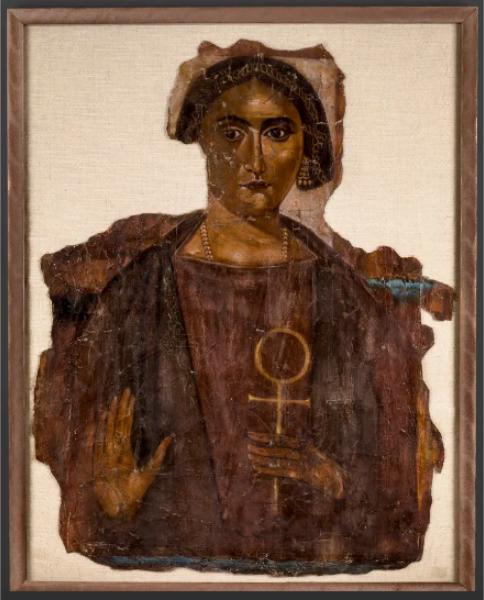

<h3>Bibliografía</h3>

<a href="../bibliografia#^642af8">Barakat Gallery, 2026</a>

<a href="../bibliografia#^595f8a">Pierre Bergé & associés, 2009</a>

<h3>Valoración</h3>

Colección privada

***

La representación pintada en el sudario es prácticamente idéntica a otra que conserva el Museo del Louvre, <a href="../seccion-retratos/RII0419">RII0419</a>.

<nav class="ficha-apartados">

<button type="button" class="boton-papiro" data-estudio="museologia">Museología</button>

<button type="button" class="boton-papiro" data-estudio="retratistica">Retratística</button>

<button type="button" class="boton-papiro" data-estudio="complementos">Complementos</button>

<button type="button" class="boton-papiro" data-estudio="sociologia">Sociología</button>

</nav>

