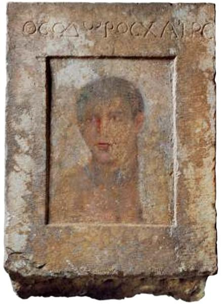

<h3>Bibliografía</h3>

<a href="../bibliografia#aravantinos2010">Aravantinos, 2010</a>

<a href="../bibliografia#brecoulaki2014">Brecoulaki, 2014</a>

<a href="../bibliografia#evangelista2013">Evangelista, 2013</a>

<h3>Valoración</h3>

Archaeological Museum of Thebes, Tebas, Grecia

***

Como todos los ejemplares cuyo nombre no comienza con la letra “P”, esta obra <a href="../Seccion-acercade/Que-es-un-RdelF">no es considerada aquí un retrato de el-Fayum</a>. La razón radica en que su soporte no es mueble. Sin embargo, la letra “R” identifica para nosotros un retrato que, en algún caso, algún autor, podría considerar dentro del corpus, bien porque su valoración sea menos estricta que la nuestra, bien porque aprecie detalles personalizados que alejen la representación de la tipicidad puramente egipcia.

«Estela funeraria. En una de sus caras, dentro de un marco tallado, aparece un retrato pintado en excelente estado de conservación, acompañado por la inscripción “THEODOROS CHAIRE”. En la otra cara, dentro de un marco similar y sin retrato alguno, figura la inscripción “THEODOROS CHRESTOS”. Es probable que la estela fuera reutilizada para distintos miembros de una misma familia: la primera vez a finales del periodo helenístico y, posteriormente, durante el siglo I a. C.» (Aravantinos, 2010, p. 321).

<nav class="ficha-apartados"></nav>

