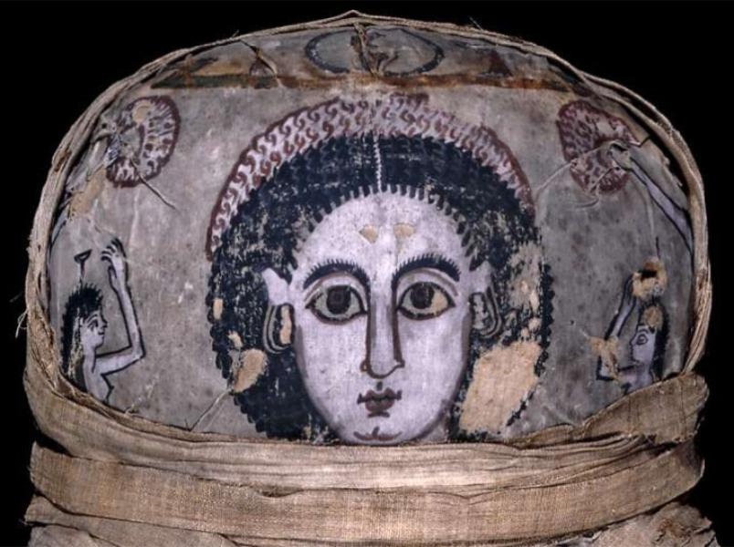

<h3>Bibliografía</h3>

MR = <a href="https://www.britishmuseum.org/collection/object/Y_EA6707">British Museum-retrato</a>

<h3>Valoración</h3>

British Museum (EA6707), Londres, Reino Unido

***

Esta momia presenta una particularidad única. Se encontró dentro de un sarcófago (<a href="https://www.britishmuseum.org/collection/object/Y_EA6706">British Museum EA6706</a>) que, en su fondo, tiene un dibujo cuyo rostro es casi exactamente igual al del enfardado.

Restos momificados de una joven llamada Cleopatra, hija de Candace y miembro de la familia de Cornelio Polio, arconte de Tebas. Las inscripciones en su ataúd indican que falleció a la edad de 17 años, 1 mes y 25 días (MR).

Tanto la representación de su sudario, como la del fondo del sarcófago, sitúan esta imagen en el grupo de las no individualizadas y, por tanto, fuera de nuestro interés inmediato.

<nav class="ficha-apartados">

<button type="button" class="boton-papiro" data-estudio="museologia">Museología</button>

<button type="button" class="boton-papiro" data-estudio="retratistica">Retratística</button>

<button type="button" class="boton-papiro" data-estudio="complementos">Complementos</button>

<button type="button" class="boton-papiro" data-estudio="sociologia">Sociología</button>

</nav>

