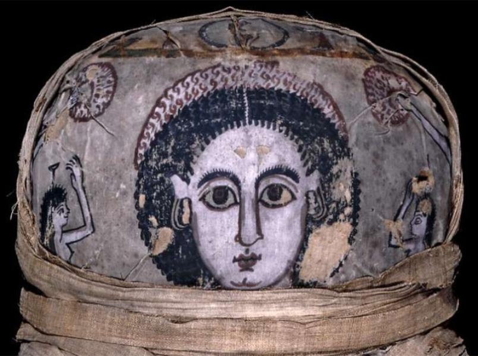

<h3>Bibliografía</h3>

<a href="../bibliografia#^642af8">Barakat Gallery, 2026</a>

<a href="../bibliografia#^595f8a">Pierre Bergé & associés, 2009</a>

<h3>Valoración</h3>

Colección privada

***

Como todos los ejemplares cuyo nombre no comienza con la letra "P", esta obra <a href="../Seccion-acercade/Que-es-un-RdelF">no es considerada aquí un retrato de el-Fayum</a>. La razón radica en que la difunta no está individualizada. Sin embargo, la letra "R" identifica para nosotros un retrato que, en algún caso, algún autor, podría considerar dentro del corpus, bien porque su valoración sea menos estricta que la nuestra, bien porque aprecie detalles personalizados que alejen la representación de la tipicidad puramente egipcia.

La representación pintada en el sudario es prácticamente idéntica a otra que conserva el Museo del Louvre y aquí hemos numerado a continuación <a href="../seccion-retratos/Rad004">Rad004</a>.

<nav class="ficha-apartados"></nav>

